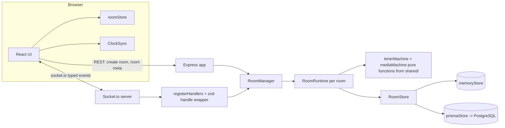

# StudyRoom

Real-time study rooms you can open in a browser and share with a link. Create a room, send the
6-character code, and everyone inside shares one **server-authoritative Pomodoro timer**, a live
member list with per-person status and current task, chat with typing indicators, and one YouTube
video that plays in step on every screen. No accounts:
you pick a nickname, the app remembers you, and if you refresh or lose connection your seat is
waiting for you.

**Features**

- Rooms by code or link (`/r/:CODE`), optional password, max 30 members
- Shared timer: focus / break / long break, four presets (25/5, 15/3, 50/10, 90/20) or your own
  durations, cycles before long break, optional auto-start, controlled by the host, host-appointed
  moderators, or everyone
- Presence that survives a refresh: grace period, multi-tab as one member, automatic host transfer
- Host-only member menu: moderator, mute, kick and ban, each confirmed, with a list to lift blocks
- Chat with last 100 messages persisted, typing indicator, translated system lines
- Per-member status (Focusing / Break / Away) and "current task" text
- Shared music: a host or moderator pastes a YouTube link and the whole room plays the same video at
  the same position, with play, seek, loop and clear in sync. The picture is a small bar (or a still
  cover) rather than a window, because this is a room for working
- Phase-change chime synthesised with WebAudio (no audio files), sound toggle and a picker for 10 chime
  voices, saved per device
- Ambient noise (white, pink, brown, rain, waves) synthesised locally, with a volume slider and an
  only-during-focus switch. Nobody else in the room hears it, and nothing about it is sent anywhere
- Opt-in focus tracking: while a focus phase runs, the room sees only that your tab was hidden, and you
  get an away count, a focus percentage for the session and a list of your last ten sessions
- Catppuccin themes: Mocha (dark) and Latte (light), flash-free; the system setting decides the first
  run and the toggle only ever switches between those two
- JetBrains Mono across the whole UI: a locally installed JetBrainsMono Nerd Font is used when present,
  otherwise a bundled subset webfont (~40 kB for latin) is served
- English and Indonesian, switchable at runtime
- Every personal setting (theme, language, sounds, volumes, ambient, timer style, focus opt-in, music
  volume) lives in `localStorage` on your device, not in the room

## Screenshots

Not captured yet. Add them to `docs/screenshots/` (see the note in that folder) and link them here:
`home-mocha.png`, `home-latte.png`, `room-desktop.png`, `room-mobile.png`.

## Architecture



**Server-authoritative timer.** The server never trusts a client's countdown. A running phase is
stored as an absolute deadline: `endsAt = now + remainingMs` in *server* epoch milliseconds, plus
`remainingMs` for the paused/idle case. Clients only render
`max(0, endsAt - serverNowEstimate())`. Because the deadline is absolute, a server restart, a
sleeping laptop, or a tab that was throttled in the background cannot drift the timer: when the
server boots it reloads the room, sees that `endsAt` is in the past, and completes the overdue phase
exactly once. Client clocks are aligned with a `time:sync` round trip — five samples on connect,
`offset = serverNow + rtt/2 - receivedAt`, and the sample with the **smallest RTT** wins; it re-syncs
every 30 s and when the tab becomes visible again. Client intervals would have made every browser a
separate source of truth, and two tabs would disagree within a minute.

**Reconnect and grace period.** Each member holds a *set* of sockets, so several tabs are one
member. When the last socket drops, the member is marked offline and a grace timer starts
(`PRESENCE_GRACE_MS`, 15 s by default). Reconnecting with the same `clientId` cancels it and reclaims
the same seat, nickname, task and host flag; only when the grace period expires is the member
removed and `member:left` broadcast. An explicit `room:leave` (navigating away) removes immediately.
If the room empties while the timer runs, the timer is paused so nobody returns to a finished
session.

**Host transfer.** The host can transfer the role to any online member. If the host leaves or drops
past the grace period, the role goes automatically to the online member with the smallest
`joinedAt`, and the new state is persisted before `room:hostChanged` is broadcast.

**Moderators.** There is always exactly one host, but the host can hand out a lower tier: the three-dot
menu on a member row offers timer control, make host, mute, kick and ban. A moderator may drive the
timer and the shared music — start, pause, reset, skip, and every `media:*` command — and nothing else:
room settings, role changes and moderation stay host-only, and every one of those checks is enforced on
the server, not just hidden in the UI. Promoting a moderator to host clears the flag. In chat the host's
name is gold and a moderator's is silver. The list of moderator `clientId`s is stored on the room row
(`modClientIds`), so a server restart restores the tier along with the room; a moderator who is not
present is simply not shown until they rejoin.

**Kick and ban.** Mute blocks chat only: `chat:send` answers `MUTED` and that member's typing
indicators are dropped without a broadcast. A kick writes a `RoomBlock` row that expires after 15
minutes; a ban is the same row with no expiry. Both remove the member at once with `room:kicked`, which
is what makes the removed tab forget its session and show a "you were removed" screen instead of
rejoining in a loop. Blocked ids are refused at the door by `room:join` (`KICKED` / `BANNED`) even under
a new nickname, and the host can lift any block early from the "Blocked" list. Blocks are stored by
`userId`, never by `clientId`.

**Shared music.** Like the timer, the video is server state: `{ videoId, status, anchorPositionMs,
anchorAt, loop, version }`, mutated only through the pure `mediaMachine` in `shared/` and broadcast as
`media:state`. The server keeps the validated 11-character id, never a URL — `parseYouTubeVideoId`
accepts watch / youtu.be / embed / shorts / live / music.youtube.com / mobile links and a bare id, and
rejects every other host, look-alike hosts, userinfo tricks, `javascript:` and playlist-only links. The
client builds the embed through the official IFrame API with that id, so no user string ever becomes a
frame `src`. Everyone's position is derived from the same server clock the timer uses, then corrected
locally when it drifts more than 2 s (never while buffering, never for a live stream); a looped video
wraps instead of ending. `media:*` is limited to 6 commands per 10 s per person. Only the id, the
position and who set it are shared — the video's title is read from the player and stays on the device
that played it. If a video cannot be embedded, the person who is watching sees why and nobody else's
room breaks.

**Sound on your own device.** The chime, the ten alert voices and the ambient noise are all synthesised
with WebAudio: no audio files ship with the app and no audio event touches the socket. Ambient is a
local loop with its own volume, optionally gated to the focus phase, and the only trace of it in the
room is the tint on your own header icon.

**Focus tracking (opt-in).** `focus:state` carries exactly one boolean: this tab is hidden. The server
does the arithmetic — `awayCount`, `awayMs` and the active window of the running focus phase are
measured with the server clock in `server/src/focus/focusTracker.ts`, and a session summary is emitted
when a focus phase completes, is skipped or is reset. What leaves the device is a count and a duration;
which tab, window or application took its place never does, and the server has no field to put it in.
It is an accountability aid, not enforcement: switching to another monitor or another browser window on
a visible screen reports nothing.

**Identity model.** The browser generates one `clientId` (UUID v4) and keeps it in `localStorage`.
It is a secret: it is sent only to the server on join and is never broadcast. Everything other users
see is `userId`, the first 12 hex characters of `sha256(clientId + ":" + roomId)` — stable per room,
so a refresh looks like the same person, and unlinkable across rooms. Nicknames are de-duplicated
per room (`Anna`, `Anna (2)`, ...) and sanitized (control characters and zero-width/invisible
formatting characters are stripped).

**Why `shared/` exists.** `shared/` holds the Zod schemas, the event maps
(`ClientToServerEvents` / `ServerToClientEvents`) and the pure machines. The server instantiates
`Server<C2S, S2C, ...>` and the client `Socket<S2C, C2S>` with those same maps, so a renamed event or
a changed payload is a compile error on both sides instead of a runtime surprise. The timer and media
machines are pure (`start`, `pause`, `reset`, `complete`, `skip`, `applySettings`; `setVideo`, `play`,
`pause`, `seek`, `setLoop`, `clear` — no I/O, no `setTimeout`, every function returns a new object with
`version + 1`, or the *same* object when there is nothing to change, which is how callers know not to
broadcast or write to disk), which is why they can be tested exhaustively in `shared` and reused by the
server and by the client's sync engine without a second implementation.

## Getting started

Requires **Node >= 22** (developed on Node 24) and **npm**. `npm install` also runs
`prisma generate`, so TypeScript has the database types right away.

```bash
npm install
```

### Quick start (no database)

The in-memory store keeps rooms and messages in process memory: everything works, nothing survives a
server restart.

```bash
# bash / Git Bash
STORE=memory npm run dev

# PowerShell
$env:STORE="memory"; npm run dev
```

Or start the two processes separately:

```bash
npm run dev:memory -w server   # terminal 1
npm run dev -w client          # terminal 2
```

Open <http://localhost:5173>, create a room, then open the printed link in a **private window** (a
private window gets its own `clientId`, so it behaves like a second person).

To see the moderation menu, use the host window: the ⋮ on the other member asks for confirmation
before a role change or a removal, "Blocked" in the Members header lists kicks and bans and lifts them,
and the removed window lands on a "you were removed" screen instead of rejoining.

To see the music sync, paste a YouTube link in the host window and click **Play**. The second window
gets the same video; the first time, it needs one click on **Join the music** (browsers refuse to start
audio on their own). After that, pause, seek, loop and clear land in both windows within a second, and
so does a refresh — the reloaded window resumes at the room's current position.

### Full start (Postgres)

```bash
docker compose up -d db
cp .env.example .env           # PowerShell: Copy-Item .env.example .env
npm run db:push                # creates the tables (v1 uses db push, not migrations)
npm run dev
```

`docker compose up` (without `-d db`) also builds and runs the server container on port 3001.
Re-run `npm run db:push` after pulling, whenever `schema.prisma` changed — that is how an existing
database gains the `RoomBlock` table and, from the add-on features, the `Room` columns `modClientIds`,
`strictFocus`, `mediaVideoId` and `mediaLoop`. The app starts and reads fine against an old database
but every new feature fails to persist, so push first if music or moderators will not survive a restart.

### Environment variables

Copy `.env.example` to `.env` at the repo root. The server loads it with `dotenv`; Vite only sees
variables prefixed with `VITE_`.

| Variable | Default | Used by | Meaning |
| --- | --- | --- | --- |
| `PORT` | `3001` | server | HTTP + Socket.io port |
| `CORS_ORIGIN` | `http://localhost:5173` | server | Comma-separated allow-list for REST and Socket.io |
| `DATABASE_URL` | — | server | Postgres connection string (required for `STORE=prisma`) |
| `STORE` | `prisma` | server | `prisma` or `memory`; falls back to memory with a warning if `DATABASE_URL` is missing |
| `PRESENCE_GRACE_MS` | `15000` | server | How long a dropped socket keeps its seat |
| `MAX_MEMBERS` | `30` | server | Hard cap per room (validation rejects anything above 30) |
| `ROOM_TTL_DAYS` | `7` | server | Inactive rooms are deleted after this many days |
| `TRUST_PROXY` | `0` | server | Set `1` behind Render/Railway so rate limits see real IPs |
| `VITE_SERVER_URL` | *(empty)* | client | Empty in dev (Vite proxies `/api` and `/socket.io`); the server URL in production |

### Scripts

| Script | What it does |
| --- | --- |
| `npm run dev` | Server (`tsx watch`) and client (`vite`) together |
| `npm run dev -w server` / `-w client` | Either one alone |
| `npm run dev:memory -w server` | Server with the in-memory store, no env needed |
| `npm run build` | `prisma generate && tsup` for the server, `vite build` for the client |
| `npm run typecheck` | `tsc --noEmit` in all three workspaces |
| `npm test` | Vitest in all three workspaces |
| `npm run db:push` | Apply `server/prisma/schema.prisma` to `DATABASE_URL` |
| `npm run db:generate` | Regenerate the Prisma client |

### Tests

```bash
npm test
```

- **shared** — the timer machine (transitions, `autoStart`, `skip` not counting a focus session,
  `applySettings` while idle vs running, immutability, `version`), the media machine (set / play /
  pause / seek / loop / clear, `positionAt` against a fake clock, no-op identity, `effectivePositionMs`
  with and without a loop, `computeCorrection` thresholds and buffering), `parseYouTubeVideoId`
  (every accepted link shape, every rejected host, trick and length), `TIMER_PRESETS` inside `LIMITS`
  and the Zod schemas.
- **server unit** — text sanitizing, the token-bucket and failure rate limiters (fake clock), id
  generation, REST routes, the focus tracker (every transition: pause freezes but never ends, away
  across a phase boundary counts once, disconnect while away, `focusPct` clamping, empty sessions),
  and `RoomRuntime` with a fake clock: phase auto-advance, auto-start chaining, grace removal,
  reconnect cancelling grace, host transfer, empty-room pause, nickname de-duplication, timer
  permissions, moderator appointments, mute, kick/ban blocks and their cooldown, block list, boot
  recovery, media transitions and their limiter, media persisting and reloading as paused, and focus
  summaries emitted on complete / skip / reset but never on a pause.
- **server integration** — the real HTTP + Socket.io server on a random port with two or three
  `socket.io-client` instances: presence, chat, passwords, permissions, grace/reconnect, host
  transfer, moderators, mute, kick/ban (`room:kicked`, rejoin refused, unban), rate limits,
  `time:sync`, shared media (member refused, host and moderator accepted, both windows get the same
  `media:state`, a late joiner's snapshot carries the video, bad links and `NO_MEDIA`), and focus
  tracking end to end (opt-in, away counts observed by the other member, summary on skip).
- **client** — i18n key/placeholder parity between `en` and `id`, `formatRemaining`, clock-offset
  selection, chat name colours per role, the ten alert voices and the noise generator, preset matching,
  the preference migration (an old stored object without the new keys), local focus history keeping ten
  entries, the room store (snapshot replacement, system lines, out-of-order timer and media versions,
  typing expiry, removal of a kicked member and the self-kicked screen), and the media sync engine
  against a fake player (load / seek / play call order, no correction while buffering or on a live
  stream, loop wrapping, local ending, the autoplay watchdog).

There is no jsdom in the client workspace, so client tests only cover DOM-free modules: pure `lib/*`
helpers and the zustand stores. Anything that touches the DOM lives behind a hook that is verified by
hand in two tabs.

## Privacy

- **What the server keeps.** Room name and code, a bcrypt hash if you set a password, the timer state,
  the last 100 messages, the member roster (nickname, status, task, host and moderator flags), kick/ban
  blocks, and the shared video id plus its loop flag. Rooms are deleted after `ROOM_TTL_DAYS` of
  inactivity.
- **What identifies you.** A random UUID (`clientId`) in `localStorage`, sent only when you join. Other
  people see `userId`, a truncated hash of it scoped to one room, so your activity in one room cannot be
  linked to another.
- **What focus tracking shares.** That this browser tab was hidden, counted and totalled by the server.
  It never sees a URL, a page title, an app name, a screenshot or anything else about what you did
  instead. Your opt-in choice and your own session history stay on the device.
- **What the music feature shares.** The 11-character video id, who set it, and where the room is in
  the video. The player's title is read locally and displayed locally. YouTube itself sees the embed as
  an ordinary visit from your browser (the frame is served from `youtube-nocookie.com`, which reduces
  but does not eliminate that), and nothing about playback is reported back to this app's server.
- **What never leaves your device.** Theme, language, timer style, chime voice and volume, ambient
  noise choice and volume, music volume and the listen switch, focus opt-in, and the last ten focus
  sessions — all in `localStorage`.

## Windows / PowerShell notes

- Set an env var for one session with `$env:NAME="value"` (e.g. `$env:STORE="memory"; npm run dev`).
  There is no `export`; `$env:` does not survive closing the terminal.
- All scripts are npm scripts or Node/TypeScript — nothing is bash-only, so they work in PowerShell,
  cmd and Git Bash alike. `npm run dev:memory -w server` exists precisely so the memory quick start
  needs no shell-specific syntax and no `cross-env`.
- `.gitattributes` sets `* text=auto eol=lf`, so files stay LF even with `core.autocrlf=true`.
- Docker needs Docker Desktop with the WSL2 backend for `docker compose up -d db`.
- If port 5173 is taken, Vite moves to 5174 and the server's `CORS_ORIGIN` no longer matches — in dev
  this is harmless because the client talks to Vite and Vite proxies to `localhost:3001`.

## Deployment

**1. Database — Neon (or Supabase).** Create a free Postgres project, copy the pooled connection
string. No setup beyond that: the schema is applied by the server container on boot
(`prisma db push --skip-generate`), or run `npm run db:push` once yourself with
`DATABASE_URL` pointing at it.

**2. Server — Render (Docker).** Push the repo, then either "New +" → "Blueprint" and pick
`render.yaml`, or create a Web Service manually with:

- Runtime: **Docker**, Dockerfile `server/Dockerfile`, context = repo root
- Health check path: `/health`
- Env vars: `STORE=prisma`, `DATABASE_URL` (Neon), `CORS_ORIGIN=https://your-app.vercel.app`,
  `TRUST_PROXY=1`. Optional: `PRESENCE_GRACE_MS`, `MAX_MEMBERS`, `ROOM_TTL_DAYS`.
- `PORT` is injected by Render; the server reads it.

Free instances sleep after inactivity, so the first visit can take ~50 s. The client handles it: the
connection banner shows "Reconnecting…" and Socket.io keeps retrying until the instance is awake.

**3. Client — Vercel.** Import the repo with:

- Root Directory: *(repo root)*
- Build Command: `npm run build -w client`
- Output Directory: `client/dist`
- Env var: `VITE_SERVER_URL=https://your-server.onrender.com`
- Add the server's URL to `CORS_ORIGIN` on Render (comma-separated for several origins).

The SPA rewrite lives in `client/vercel.json`. Vercel only reads a `vercel.json` at the project root,
so if you keep Root Directory = repo root, copy that same JSON into a root `vercel.json` (or set Root
Directory to `client`, which uses the file where it is).

`VITE_SERVER_URL` is inlined at build time — rebuild the client after changing it.

## Project layout

```
shared/   constants, zod schemas, types, typed event maps, pure timer + media machines, YouTube parser
server/   express + socket.io, RoomManager/RoomRuntime, focus tracker, memory + prisma stores, prisma schema
client/   react 19 + vite 7 + tailwind 4, zustand stores, media sync engine, i18n (en/id), Catppuccin themes
```

`shared/` is consumed as TypeScript source: the server bundles it with `tsup`
(`noExternal: ['@studyroom/shared']`), the client resolves it through the npm workspace and Vite.

## Known limitations / roadmap

- **Single server instance.** Presence, grace timers and phase scheduling live in process memory, so
  running more than one replica would split rooms. Scaling out needs the Socket.io Redis adapter plus
  shared presence state and a single scheduler owner per room.
- **Guest identity can be spoofed.** Clearing `localStorage` creates a new `clientId`, i.e. a new
  person; a leaked `clientId` lets someone rejoin as you. Accounts (or signed join tokens) would fix
  this.
- **`prisma db push` instead of migrations.** Fine for v1 and for a schema that is only added to, but
  a destructive change needs `prisma migrate` with real migration files.
- **Focus tracking sees the tab, not the person.** It is built on `document.visibilityState`, which
  fires when the tab is backgrounded or the device sleeps. Moving the window aside, using a second
  monitor, or opening another browser window while this one stays visible reports nothing, and a
  determined person can simply leave the tab open. It cannot block a site, an app or a phone, and it is
  not a productivity measurement — it is one honest number about one tab, opt-in, shared only with the
  room you are in.
- **Music depends on YouTube.** Only videos whose owner allows embedding can play, so a private,
  removed or embed-blocked video shows a plain "this cannot be played here" line to the people watching
  it; the room keeps running either way. Playback starts only after a click (`Join the music`), because
  browsers require a gesture before sound. Positions are matched against the server clock and corrected
  when a device drifts more than two seconds, so windows agree to roughly a second, not to the
  millisecond, and a livestream has no position to match at all. The player is an iframe from
  `youtube-nocookie.com`, drawn small on purpose (a 16:9 bar 144 px wide): an embed picks its stream from
  the size it is rendered at, so a compact player is the difference between buffering and not. It stays
  on screen while it has something to play, and `Show cover` puts a still of the video above it for the
  people who would rather look at a wall. The iframe has no controls of its own — `pointer-events` are
  off, and the drift check restarts it if it ever falls out of playback on its own — so the room's
  buttons are the only thing that decides whether sound is coming out. On a phone the player is only
  built once the card is actually on screen, so a listener who never opens the Music tab gets it the
  moment the room starts playing.
- Rooms are deleted after `ROOM_TTL_DAYS` of inactivity; messages are capped at the last 100 per room.
- No end-to-end browser tests (Vitest only). Use the two-tab recipe above to check the room page,
  the shared music and the focus summary by hand.
