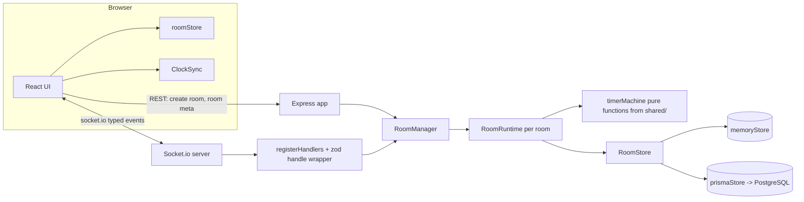

# StudyRoom

Real-time study rooms you can open in a browser and share with a link. Create a room, send the
6-character code, and everyone inside shares one **server-authoritative Pomodoro timer**, a live
member list with per-person status and current task, and chat with typing indicators. No accounts:
you pick a nickname, the app remembers you, and if you refresh or lose connection your seat is
waiting for you.

**Features**

- Rooms by code or link (`/r/:CODE`), optional password, max 30 members
- Shared timer: focus / break / long break, configurable durations, cycles before long break,
  optional auto-start, host-only or everyone-can-control
- Presence that survives a refresh: grace period, multi-tab as one member, automatic host transfer
- Chat with last 100 messages persisted, typing indicator, translated system lines
- Per-member status (Focusing / Break / Away) and "current task" text
- Phase-change chime generated with WebAudio (no audio files), sound toggle
- Catppuccin themes: Mocha (dark) and Latte (light), flash-free, follows the system by default
- English and Indonesian, switchable at runtime

## Screenshots

Not captured yet. Add them to `docs/screenshots/` (see the note in that folder) and link them here:
`home-mocha.png`, `home-latte.png`, `room-desktop.png`, `room-mobile.png`.

## Architecture



**Server-authoritative timer.** The server never trusts a client's countdown. A running phase is
stored as an absolute deadline: `endsAt = now + remainingMs` in *server* epoch milliseconds, plus
`remainingMs` for the paused/idle case. Clients only render
`max(0, endsAt - serverNowEstimate())`. Because the deadline is absolute, a server restart, a
sleeping laptop, or a tab that was throttled in the background cannot drift the timer: when the
server boots it reloads the room, sees that `endsAt` is in the past, and completes the overdue phase
exactly once. Client clocks are aligned with a `time:sync` round trip — five samples on connect,
`offset = serverNow + rtt/2 - receivedAt`, and the sample with the **smallest RTT** wins; it re-syncs
every 30 s and when the tab becomes visible again. Client intervals would have made every browser a
separate source of truth, and two tabs would disagree within a minute.

**Reconnect and grace period.** Each member holds a *set* of sockets, so several tabs are one
member. When the last socket drops, the member is marked offline and a grace timer starts
(`PRESENCE_GRACE_MS`, 15 s by default). Reconnecting with the same `clientId` cancels it and reclaims
the same seat, nickname, task and host flag; only when the grace period expires is the member
removed and `member:left` broadcast. An explicit `room:leave` (navigating away) removes immediately.
If the room empties while the timer runs, the timer is paused so nobody returns to a finished
session.

**Host transfer.** The host can transfer the role to any online member. If the host leaves or drops
past the grace period, the role goes automatically to the online member with the smallest
`joinedAt`, and the new state is persisted before `room:hostChanged` is broadcast.

**Identity model.** The browser generates one `clientId` (UUID v4) and keeps it in `localStorage`.
It is a secret: it is sent only to the server on join and is never broadcast. Everything other users
see is `userId`, the first 12 hex characters of `sha256(clientId + ":" + roomId)` — stable per room,
so a refresh looks like the same person, and unlinkable across rooms. Nicknames are de-duplicated
per room (`Anna`, `Anna (2)`, ...) and sanitized (control characters and zero-width/invisible
formatting characters are stripped).

**Why `shared/` exists.** `shared/` holds the Zod schemas, the event maps
(`ClientToServerEvents` / `ServerToClientEvents`) and the pure timer machine. The server instantiates
`Server<C2S, S2C, ...>` and the client `Socket<S2C, C2S>` with those same maps, so a renamed event or
a changed payload is a compile error on both sides instead of a runtime surprise. The timer machine
is pure (`start`, `pause`, `reset`, `complete`, `skip`, `applySettings` — no I/O, no `setTimeout`,
every function returns a new object with `version + 1`), which is why it can be tested exhaustively
in `shared` and reused by the server without a second implementation.

## Getting started

Requires **Node >= 22** (developed on Node 24) and **npm**. `npm install` also runs
`prisma generate`, so TypeScript has the database types right away.

```bash
npm install
```

### Quick start (no database)

The in-memory store keeps rooms and messages in process memory: everything works, nothing survives a
server restart.

```bash
# bash / Git Bash
STORE=memory npm run dev

# PowerShell
$env:STORE="memory"; npm run dev
```

Or start the two processes separately:

```bash
npm run dev:memory -w server   # terminal 1
npm run dev -w client          # terminal 2
```

Open <http://localhost:5173>, create a room, then open the printed link in a **private window** (a
private window gets its own `clientId`, so it behaves like a second person).

### Full start (Postgres)

```bash
docker compose up -d db
cp .env.example .env           # PowerShell: Copy-Item .env.example .env
npm run db:push                # creates the tables (v1 uses db push, not migrations)
npm run dev
```

`docker compose up` (without `-d db`) also builds and runs the server container on port 3001.

### Environment variables

Copy `.env.example` to `.env` at the repo root. The server loads it with `dotenv`; Vite only sees
variables prefixed with `VITE_`.

| Variable | Default | Used by | Meaning |
| --- | --- | --- | --- |
| `PORT` | `3001` | server | HTTP + Socket.io port |
| `CORS_ORIGIN` | `http://localhost:5173` | server | Comma-separated allow-list for REST and Socket.io |
| `DATABASE_URL` | — | server | Postgres connection string (required for `STORE=prisma`) |
| `STORE` | `prisma` | server | `prisma` or `memory`; falls back to memory with a warning if `DATABASE_URL` is missing |
| `PRESENCE_GRACE_MS` | `15000` | server | How long a dropped socket keeps its seat |
| `MAX_MEMBERS` | `30` | server | Hard cap per room (validation rejects anything above 30) |
| `ROOM_TTL_DAYS` | `7` | server | Inactive rooms are deleted after this many days |
| `TRUST_PROXY` | `0` | server | Set `1` behind Render/Railway so rate limits see real IPs |
| `VITE_SERVER_URL` | *(empty)* | client | Empty in dev (Vite proxies `/api` and `/socket.io`); the server URL in production |

### Scripts

| Script | What it does |
| --- | --- |
| `npm run dev` | Server (`tsx watch`) and client (`vite`) together |
| `npm run dev -w server` / `-w client` | Either one alone |
| `npm run dev:memory -w server` | Server with the in-memory store, no env needed |
| `npm run build` | `prisma generate && tsup` for the server, `vite build` for the client |
| `npm run typecheck` | `tsc --noEmit` in all three workspaces |
| `npm test` | Vitest in all three workspaces |
| `npm run db:push` | Apply `server/prisma/schema.prisma` to `DATABASE_URL` |
| `npm run db:generate` | Regenerate the Prisma client |

### Tests

```bash
npm test
```

- **shared** — the timer machine (transitions, `autoStart`, `skip` not counting a focus session,
  `applySettings` while idle vs running, immutability, `version`) and the Zod schemas.
- **server unit** — text sanitizing, the token-bucket and failure rate limiters (fake clock), id
  generation, REST routes, and `RoomRuntime` with a fake clock: phase auto-advance, auto-start
  chaining, grace removal, reconnect cancelling grace, host transfer, empty-room pause, nickname
  de-duplication, timer permissions, boot recovery.
- **server integration** — the real HTTP + Socket.io server on a random port with two
  `socket.io-client` instances: presence, chat, passwords, permissions, grace/reconnect, host
  transfer, rate limits, `time:sync`.
- **client** — i18n key/placeholder parity between `en` and `id`, `formatRemaining`, clock-offset
  selection, and the room store (snapshot replacement, system lines, out-of-order timer versions,
  typing expiry).

## Windows / PowerShell notes

- Set an env var for one session with `$env:NAME="value"` (e.g. `$env:STORE="memory"; npm run dev`).
  There is no `export`; `$env:` does not survive closing the terminal.
- All scripts are npm scripts or Node/TypeScript — nothing is bash-only, so they work in PowerShell,
  cmd and Git Bash alike. `npm run dev:memory -w server` exists precisely so the memory quick start
  needs no shell-specific syntax and no `cross-env`.
- `.gitattributes` sets `* text=auto eol=lf`, so files stay LF even with `core.autocrlf=true`.
- Docker needs Docker Desktop with the WSL2 backend for `docker compose up -d db`.
- If port 5173 is taken, Vite moves to 5174 and the server's `CORS_ORIGIN` no longer matches — in dev
  this is harmless because the client talks to Vite and Vite proxies to `localhost:3001`.

## Deployment

**1. Database — Neon (or Supabase).** Create a free Postgres project, copy the pooled connection
string. No setup beyond that: the schema is applied by the server container on boot
(`prisma db push --skip-generate`), or run `npm run db:push` once yourself with
`DATABASE_URL` pointing at it.

**2. Server — Render (Docker).** Push the repo, then either "New +" → "Blueprint" and pick
`render.yaml`, or create a Web Service manually with:

- Runtime: **Docker**, Dockerfile `server/Dockerfile`, context = repo root
- Health check path: `/health`
- Env vars: `STORE=prisma`, `DATABASE_URL` (Neon), `CORS_ORIGIN=https://your-app.vercel.app`,
  `TRUST_PROXY=1`. Optional: `PRESENCE_GRACE_MS`, `MAX_MEMBERS`, `ROOM_TTL_DAYS`.
- `PORT` is injected by Render; the server reads it.

Free instances sleep after inactivity, so the first visit can take ~50 s. The client handles it: the
connection banner shows "Reconnecting…" and Socket.io keeps retrying until the instance is awake.

**3. Client — Vercel.** Import the repo with:

- Root Directory: *(repo root)*
- Build Command: `npm run build -w client`
- Output Directory: `client/dist`
- Env var: `VITE_SERVER_URL=https://your-server.onrender.com`
- Add the server's URL to `CORS_ORIGIN` on Render (comma-separated for several origins).

The SPA rewrite lives in `client/vercel.json`. Vercel only reads a `vercel.json` at the project root,
so if you keep Root Directory = repo root, copy that same JSON into a root `vercel.json` (or set Root
Directory to `client`, which uses the file where it is).

`VITE_SERVER_URL` is inlined at build time — rebuild the client after changing it.

## Project layout

```
shared/   constants, zod schemas, types, typed event maps, pure timer machine
server/   express + socket.io, RoomManager/RoomRuntime, memory + prisma stores, prisma schema
client/   react 19 + vite 7 + tailwind 4, zustand stores, i18n (en/id), Catppuccin themes
```

`shared/` is consumed as TypeScript source: the server bundles it with `tsup`
(`noExternal: ['@studyroom/shared']`), the client resolves it through the npm workspace and Vite.

## Known limitations / roadmap

- **Single server instance.** Presence, grace timers and phase scheduling live in process memory, so
  running more than one replica would split rooms. Scaling out needs the Socket.io Redis adapter plus
  shared presence state and a single scheduler owner per room.
- **Guest identity can be spoofed.** Clearing `localStorage` creates a new `clientId`, i.e. a new
  person; a leaked `clientId` lets someone rejoin as you. Accounts (or signed join tokens) would fix
  this.
- **`prisma db push` instead of migrations.** Fine for v1 and for a schema that is only added to, but
  a destructive change needs `prisma migrate` with real migration files.
- Rooms are deleted after `ROOM_TTL_DAYS` of inactivity; messages are capped at the last 100 per room.
- No end-to-end browser tests (Vitest only); the room page is verified manually in two tabs.
