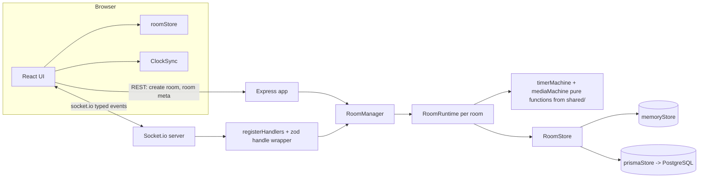

# Architecture

Real-time architecture and design rationale for StudyRoom.

## System Topology

## Core Modules

### Monorepo Workspaces

- `shared/` (`@studyroom/shared`): Pure business logic, state machines (`timerMachine`, `mediaMachine`), Zod schemas, limits, and Socket.io event interfaces (`ClientToServerEvents`, `ServerToClientEvents`). Zero dependencies beyond Zod.
- `server/` (`@studyroom/server`): Express HTTP app, Socket.io runtime, room manager (`RoomManager`), in-memory (`memoryStore`) and PostgreSQL Prisma (`prismaStore`) persistence, rate limiters, and focus session tracker.
- `client/` (`@studyroom/client`): React 19 + Vite 7 application, Tailwind CSS v4 styling, Zustand stores (`useRoomStore`, `usePrefsStore`), WebAudio synthesizer, and YouTube IFrame synchronization engine.

### Server-Authoritative Timer

The server never trusts client countdowns. Running phases store an absolute `endsAt = now + remainingMs` in server epoch milliseconds, with `remainingMs` for paused/idle states.

Clients compute rendered remaining time as `max(0, endsAt - serverNowEstimate())`. Because the deadline is absolute:
- Server reboots restore the room and immediately complete any overdue phase.
- Client clock drift and sleeping background tabs cannot desynchronize room state.
- Client clocks synchronize with a 5-sample round-trip exchange (`time:sync`):
  `offset = serverNow + rtt / 2 - receivedAt`, with the smallest RTT sample chosen. Resyncs occur every 30 seconds and on tab visibility change.

### Identity and Presence

- **Client ID**: Random UUID v4 stored in browser `localStorage`. Kept secret from other participants; transmitted only during room handshake.
- **User ID**: Public participant identifier derived as the first 12 hex characters of `sha256(clientId + ":" + roomId)`. Stable across page reloads within the same room; unlinkable across different rooms.
- **Grace Period**: Members maintain a set of active socket connections (supporting multi-tab use under one seat). On disconnection of the last socket, a 15-second grace countdown starts (`PRESENCE_GRACE_MS`). Reconnecting with the same `clientId` reclaims the seat and cancels the grace period. On expiration, `member:left` broadcasts.
- **Automatic Host Transfer**: If the room host disconnects past the grace window or leaves explicitly, host privileges automatically transfer to the online member with the earliest `joinedAt` timestamp.

### Moderation and Access Control

- **Host**: Exactly one host per room with full administrative authority (settings, transfer host, promote moderator, mute, kick, ban).
- **Moderator**: Tier appointed by the host granting shared timer and music control (`start`, `pause`, `reset`, `skip`, `media:*`). Moderator IDs persist in room storage (`modClientIds`).
- **Mute**: Presence-level chat restriction. Silences outgoing messages and typing indicators without kicking the user.
- **Kick & Ban**: Persisted in `RoomBlock` table by hashed `userId` (never secret `clientId`). A kick sets an expiration of 15 minutes; a ban sets a permanent block until lifted by the host. When removed, the client receives `room:kicked` and terminates session storage to prevent auto-rejoin loops.

### Shared Media Synchronization

- Room media state (`videoId`, `status`, `anchorPositionMs`, `anchorAt`, `loop`, `version`) is validated and maintained server-side via `mediaMachine`.
- Only validated 11-character YouTube IDs are stored; raw URLs and arbitary embeds are strictly rejected.
- Clients calculate current playback position relative to the synchronized server clock, applying small rate adjustments or seeks only when local playback drifts beyond 2 seconds.

### Focus Tracking & Privacy

- Opt-in focus tracking emits only boolean tab visibility state (`focus:state { hidden: boolean }`).
- Server calculates cumulative away duration and count against active focus phases.
- No URLs, page titles, application details, or telemetry leave the user's device.
- Personal configurations (theme, alert voices, ambient sounds, volume levels, notification preferences) reside strictly in browser `localStorage`.
